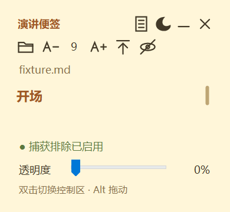
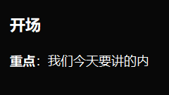

# 演讲便签 · Speech Note

一个轻量的 Windows 演讲提词工具。把 Markdown 或 TXT 讲稿放在置顶便签里，用滚轮阅读；演讲时可收起所有控制区，只留下讲稿。

使用 C# / WinForms 和 Windows 自带的 .NET Framework，不打包浏览器内核，不依赖第三方 NuGet 包。当前主程序约 **57 KB**，无需安装、管理员权限或联网。

**[下载便携版](https://github.com/Seeken-dai/speech-note/releases/latest)** · [完整使用说明](docs/使用说明.txt)

## 界面

| 紧凑便签 | 暗黑纯阅读 |
| --- | --- |
|  |  |

以上图片是内置自检使用示例文字生成的界面渲染，不是投屏效果截图。

## 功能

- **讲稿阅读**：支持 `.md`、`.markdown`、`.txt`；标题、列表、粗体、斜体、引用、行内代码和代码块。
- **置顶便签**：圆角无边框，拖动移动与缩放，浅色／暗黑主题，透明度 0%～80%。
- **纯阅读**：双击正文即可显示／隐藏全部控制区；切换时尽量保留阅读位置。
- **小尺寸**：普通模式最小 260 × 240，纯阅读模式最小 160 × 90，随系统显示缩放调整。
- **字号**：6～42，每次增减 1；普通箭头光标，点击或拖动正文不会选中文字。
- **滚动**：滚轮阅读、主题色细圆角滑块；纯阅读模式隐藏滑块。
- **系统托盘**：不占用普通任务栏应用按钮；托盘菜单可恢复窗口、切换控制区、打开文件和退出。
- **捕获排除**：使用 Windows `WDA_EXCLUDEFROMCAPTURE`；设置失败时遮住正文。
- **本地设置**：记住窗口位置、大小、字号、透明度和显示模式，不在设置中保存讲稿正文或路径。

## 开始使用

1. 从 [Releases](https://github.com/Seeken-dai/speech-note/releases) 下载 `SpeechNote-v1.0.0.zip`（后续版本按对应版本号选择）。
2. 解压到可写目录，保留 `SpeechNote.exe` 与 `SpeechNote.exe.config` 在同一目录。
3. 双击 `SpeechNote.exe`，点击文件夹图标打开讲稿，也可把文件拖到 EXE 图标上打开。
4. 鼠标移到正文上滚动阅读。图标悬停会显示用途。
5. 演讲前从观众端检查实际共享画面。

需要 **Windows 10 2004 或更新版本（含 Windows 11）**，以及 **.NET Framework 4.8**。不支持 macOS / Linux。

### 快捷操作

| 操作 | 效果 |
| --- | --- |
| `Ctrl + Alt + H` | 隐藏／显示整个便签 |
| `Ctrl + Alt + R` | 显示／隐藏全部控制区 |
| 双击正文 | 显示／隐藏全部控制区 |
| 纯阅读时 `Alt` + 左键拖动正文 | 移动便签 |
| 拖动窗口边缘或边角 | 调整大小 |
| 单击托盘图标 | 显示便签 |
| 右键托盘图标 | 打开操作菜单 |
| 短横线图标 | 收起到托盘 |
| 叉号图标／托盘菜单“退出” | 完全退出程序 |

托盘图标可能位于右下角「∧」隐藏图标区。快捷键冲突时，可用双击正文和托盘菜单操作。展开设置时会自动增大过小的便签，再次进入纯阅读时恢复之前的小尺寸。

## 投屏隐藏的适用范围

**不能保证钉钉、飞书的所有版本和共享方式都会隐藏便签。** 窗口显示“捕获排除已启用”只表示 Windows 接受了设置。请先使用无敏感内容的示例讲稿，通过另一台设备或观众端验证。若仍可见，改为只共享 PPT 应用窗口并再次验证。

- 使用 Windows 捕获排除接口的捕获方式可遵循该设置；其他捕获方式可能不遵循。
- HDMI／无线复制屏幕、采集卡以及摄像头拍屏不受此机制保护。此类场景建议使用扩展显示器，只把讲稿留在本机屏幕。
- 系统文件选择框不属于受保护的讲稿窗口，建议在共享开始前选好文件。
- 系统安全桌面、独占全屏或其他强制置顶窗口可能覆盖便签。
- 透明度不是防窥措施；本工具也不是防止程序读取文本的安全边界。

参考：[微软 SetWindowDisplayAffinity 文档](https://learn.microsoft.com/zh-cn/windows/win32/api/winuser/nf-winuser-setwindowdisplayaffinity)。

## 文本与隐私

支持 UTF-8（有／无 BOM）、UTF-16 / UTF-32（有 BOM）、GB18030 / 常见 GBK。单文件上限 4 MB。高级 Markdown 表格、复杂嵌套等按文本显示；链接只保留文字，图片只保留说明，不加载外部资源。

程序不联网、不上传讲稿。设置保存在程序旁的 `settings.ini`，目录不可写时无法记住设置。用户设置、真实讲稿、本地测试产物和编译文件不纳入 Git 跟踪；仓库里的讲稿仅为演示示例。

## 从源码构建

在 Windows PowerShell 或 PowerShell 中执行：

```powershell
.\build.ps1
```

脚本调用系统 .NET Framework 的 C# 编译器，输出到 `release/`，无需安装 .NET SDK 或还原 NuGet 包。可用 `-OutputDirectory` 指定其他输出目录。

```powershell
# 运行本地自检（会短暂创建测试窗口，需要可交互的 Windows 桌面）
.\test.ps1

# 重新构建、测试、打包，并生成 SHA256SUMS.txt
.\package.ps1 -Version 1.0.0
```

自检报告和示例界面保存在 `.local/test-output/`。当前版本有 **101 项检查**，覆盖文本编码、Markdown、安全转义、字体范围、滚动、模式切换、窗口样式、托盘生命周期及捕获排除设置。它们不替代 PPT 全屏和真实会议软件的观众端测试；无交互桌面的 CI 环境不适合直接运行这些窗口测试。

## 目录

```text
src/                     主程序
tests/                   内置自检
docs/                    使用说明与示例界面图片
examples/                演示讲稿
build.ps1                编译
test.ps1                 运行自检
package.ps1              构建、测试和打包
app.manifest             Windows 应用清单
SpeechNote.exe.config    .NET Framework 配置
release/                 本地便携版输出（忽略）
.local/                  本地历史版本与测试产物（忽略）
```

仓库目前未指定开源许可证；公开源码不等同于授予额外的使用、修改或分发许可。
